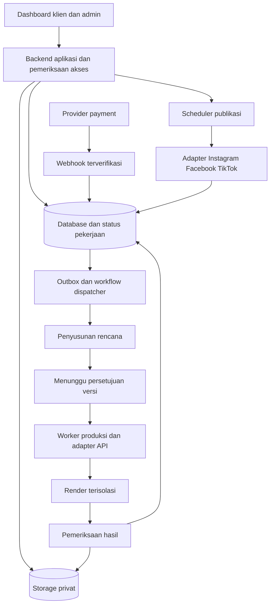

# ARD — Architecture Requirements Document

Status: DRAF. Nama ARD di sini berarti Architecture Requirements Document. Kebutuhan dibedakan dari solusi usulan; stack belum final.

## Kebutuhan arsitektur

| ID | Kebutuhan | Usulan pemenuhan |
|---|---|---|
| AR-01 | Pemisahan organisasi dan peran | organization_id, membership, pemeriksaan server, kebijakan database/storage |
| AR-02 | Pekerjaan berdurasi panjang tetap berjalan saat UI ditutup | Durable queue/workflow, worker terpisah, checkpoint persisten |
| AR-03 | Pembayaran dan persetujuan mengendalikan produksi | Event terverifikasi, versi immutable, transaksi/outbox untuk dispatch |
| AR-04 | Lebih dari 10 integrasi dapat ditambah tanpa mengubah seluruh aplikasi | Adapter per provider, capability registry, kontrak hasil yang seragam |
| AR-05 | Kegagalan provider tidak memulai ulang seluruh produksi | Retry per tahap, provider request ID, rekonsiliasi, batas biaya |
| AR-06 | Progress berasal dari pekerjaan nyata | Event job persisten dan pembaruan UI melalui polling/SSE/realtime |
| AR-07 | AI dapat membantu membuat komposisi tanpa mengakses akun/rahasia | Sandbox render terpisah, template terversi, jaringan terbatas |
| AR-08 | Penjadwalan akurat dan tahan dispatch ganda | UTC + IANA timezone, lock/lease, uniqueness, publish reconciliation |
| AR-09 | Pemulihan dan jejak keputusan tersedia | Backup/restore teruji, audit, versioning artefak, pemantauan |

## Usulan stack

Web: React/Next.js + TypeScript. Database: PostgreSQL, dengan Supabase sebagai kandidat untuk Auth/Database/Storage. Workflow/queue: pilih satu setelah pilot (misalnya managed durable workflow atau queue + worker). Renderer: worker/container Node.js dengan Remotion dan FFmpeg; compute terpisah dari request UI. Hosting dan penyimpanan final mengikuti uji biaya, ukuran media, dan kebutuhan privasi.

Ini rekomendasi awal, bukan keputusan memakai vendor. Memiliki lebih dari 10 API tidak otomatis membutuhkan microservices. Mulai dengan aplikasi modular dan worker produksi terpisah.

## Alur komponen

## Batas worker dan provider

OpenAI/Anthropic mengembalikan teks, struktur, atau kode; endpoint model tidak otomatis menyediakan seluruh pipeline render dan publikasi. Skill perlu dimuat oleh harness agen pada aplikasi. Skill yang terpasang di komputer pengembang tidak otomatis tersedia pada runtime server.

Usulan pilot: komposisi dari template terbatas dengan parameter storyboard; kode bebas oleh AI hanya jika diperlukan, tervalidasi dan dijalankan di sandbox. Tidak menerima package install arbitrer, URL jaringan arbitrer, atau kredensial production di proses render. File upload diperlakukan sebagai input data.

Audio final menjadi acuan timing video. Simpan duration/alignment dan lakukan pemeriksaan pengucapan; timestamp bukan bukti pengucapan benar. Carousel menggunakan satu komposisi per slide/parameter set dan ekspor still dalam urutan yang stabil.

## Konsistensi dan biaya

Simpan intent pekerjaan dan status dalam transaksi; outbox mencegah order paid kehilangan dispatch. Kunci persetujuan, produksi, dan publikasi mengandung versi item. Hanya satu worker memegang lease untuk operasi yang sama.

Efek eksternal tidak selalu mendukung exactly-once. Gunakan idempotency key jika provider mendukung, request ID, dan rekonsiliasi sebelum retry. Sebagian biaya dapat tetap terjadi walaupun request timeout; catat sebagai belum terkonfirmasi sampai rekonsiliasi.

Budget dipantau per tahap/item/order/provider; reserve estimasi sebelum eksekusi dan settle biaya aktual. Pause saat batas tercapai, dengan jalur penanganan operator. Provider tidak digunakan semua untuk setiap pesanan.

## Keamanan dan kapasitas

Rahasia server dalam secret manager; token OAuth terenkripsi; signed URL terikat tujuan dan TTL. Worker dengan hak istimewa tetap memeriksa organisasi, karena bypass RLS bukan alasan melepas pemeriksaan aplikasi.

Untuk Supabase: aktifkan RLS dan grants sesuai kebutuhan pada tabel yang diekspos; uji allow/deny setiap peran. Login saja tidak membuktikan hak akses ke pesanan tertentu. Sumber: [Supabase RLS](https://supabase.com/docs/guides/database/postgres/row-level-security).

Batas concurrency, timeout render, retensi aset, performa, dan pemulihan TBD. Ukur melalui pilot; jangan menjanjikan video selesai instan. Pisahkan antrean produksi dan posting agar render berat tidak menunda jadwal.

Sumber renderer: [Remotion renderer](https://www.remotion.dev/docs/renderer). Sebelum komersialisasi, periksa [lisensi](https://www.remotion.dev/docs/license/pricing) sesuai organisasi dan penggunaan; biaya lisensi dan compute adalah hal berbeda.

## Harga PAYG

Pricing engine server menentukan komponen yang relevan, tier kuantitas, allowance dan premium quote. Worker memeriksa batas job yang sudah dibayar/disetujui sebelum setiap provider call. Usage ledger terpisah dari invoice pelanggan; pembengkakan retry internal tidak otomatis menjadi charge baru. Fullset dan diskon hanya untuk pricing profile yang capability/HPP-nya tervalidasi. Mobile adalah tuntutan aplikasi menyeluruh, bukan hanya viewport preview.

## Kontrak preview dan produksi

Planner menghasilkan manifest terstruktur yang divalidasi backend. Preview builder dan renderer final menggunakan manifest/template version yang sama. Approval mengikat hash snapshot, lalu dispatcher memeriksa state/payment/budget atomik sebelum side effect. Provider generatif menghasilkan variasi yang tidak sepenuhnya dapat dikunci; variasi kualitas final tetap melalui QA terhadap manifest. Pemilihan referensi memakai registry capability/hak/aset sebelum pencocokan gaya. Prompt berbeda per tahap, tools diberi izin oleh server. Detail: [STORYBOARD-PREVIEW](STORYBOARD-PREVIEW.md), [SYSTEM-PROMPTS](SYSTEM-PROMPTS.md).
